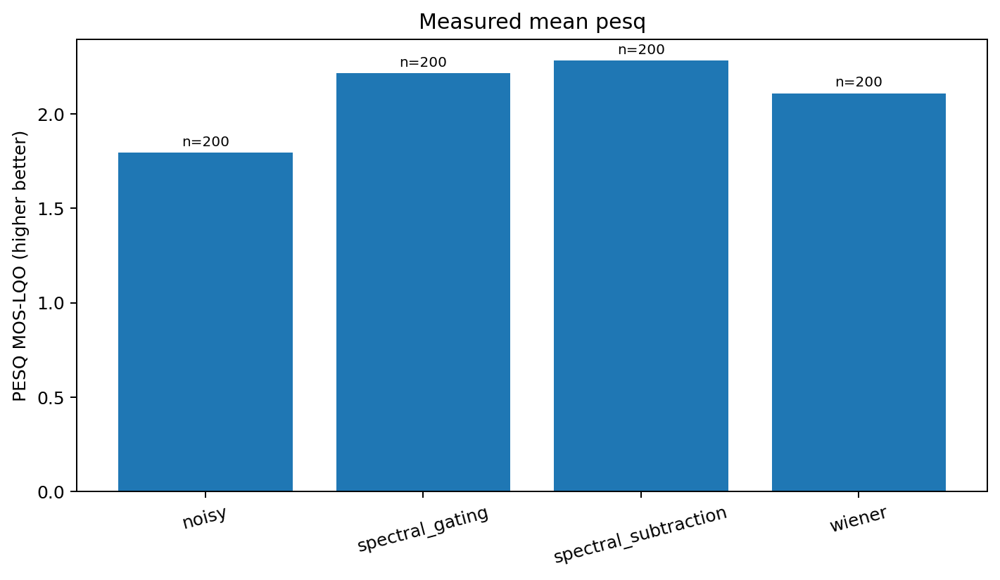
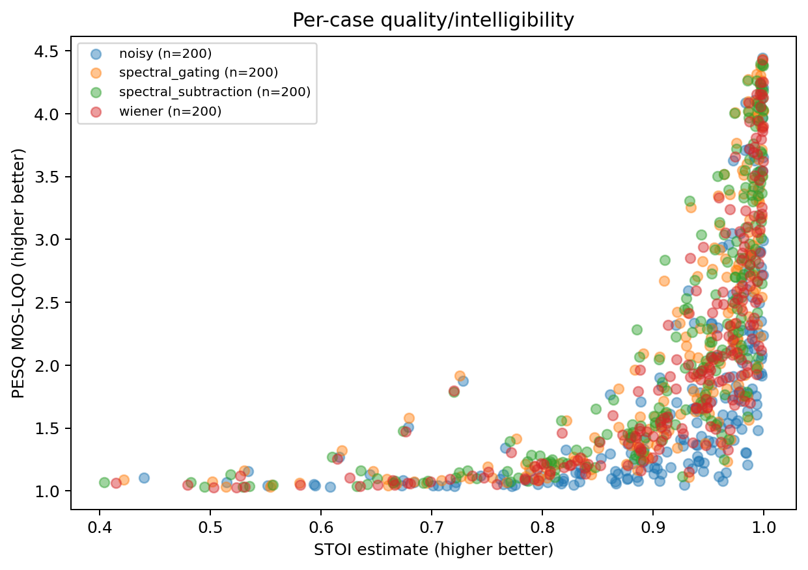

# Speech Enhancement Evaluation Benchmark

A comparative study of speech denoising algorithms, built as an end-to-end Python library.
It runs paired PESQ/STOI/reconstruction-SNR experiments over reproducible mixes, applies
statistical analysis, and generates charts and a Markdown research report.

No dataset or real-world ranking is bundled. Run the benchmark on licensed clean speech
and noise with known provenance. The bundled validation audio under
[`examples/synthetic_validation/`](examples/synthetic_validation/) is generated synthetic
test audio, not real speech recordings.

## Repository contents

The repository includes the full source tree, the technical documentation under `docs/`,
and a small synthetic sample under [`examples/synthetic_validation/`](examples/synthetic_validation/).
Original recordings and generated WAVs are excluded from Git by `.gitignore`. Unit tests
run through GitHub Actions in `.github/workflows/tests.yml`.

## Setup

Python 3.13 is recommended, or Python 3.11 with compatible pinned wheel versions (validate
the wheels for your OS):

```bash
python3 -m venv .venv
source .venv/bin/activate  # Windows: .venv\\Scripts\\activate
python -m pip install --upgrade pip
python -m pip install -e '.[dev]'
speech-benchmark doctor
pytest -q
ruff check .
```

`pesq==0.0.4` includes compiled native code, so installing it depends on your platform and
toolchain; see `docs/troubleshooting.md` and the PESQ licensing section. The project uses no Torch.

## Build your real-data manifest

Consult [`data/README.md`](data/README.md) for licensed LibriSpeech + DEMAND sources,
attribution details and the exact `manifest.json` schema. Create `data/manifest.json`
yourself after obtaining audio. Put speech and noise files under the local `data/`
directory, not in source control. Noise categories such as `fan`, `traffic`, `babble`,
`keyboard`, `household` and `stationary` should be used only when they are present in the
source recordings.

## CLI

```bash
speech-benchmark doctor
speech-benchmark inspect data/speech/utterance.flac --plot results/inspection.png
speech-benchmark prepare --config configs/benchmark.yaml --snrs=-5,0,5 --categories fan
speech-benchmark enhance --config configs/benchmark.yaml --algorithm wiener \
  --input results/benchmark/prepared/ID__0dB/noisy.wav --output results/single.wav
speech-benchmark run --config configs/benchmark.yaml
speech-benchmark run --config configs/benchmark.yaml \
  --snrs=0,5 --categories fan,traffic --max-recordings 12 \
  --algorithms noisy,spectral_subtraction,spectral_gating,wiener
speech-benchmark audit --results results/benchmark/benchmark.csv
speech-benchmark report --results results/benchmark/benchmark.csv
```

Equivalent wrappers after package installation:

```bash
python scripts/prepare_dataset.py --config configs/benchmark.yaml
python scripts/run_benchmark.py --config configs/benchmark.yaml
python scripts/generate_report.py --results results/benchmark/benchmark.csv
python scripts/inspect_audio.py data/speech/utterance.flac
```

All CLI options support `--help`. `--noise-reference PATH` enables the privileged oracle
noise mode when processing a single file; otherwise `enhance` uses blind estimation.

## Experimental configuration

Edit `configs/benchmark.yaml`, `configs/algorithms.yaml` and `configs/metrics.yaml`.
Default: 16 kHz, 4 seconds, `[−5,0,5,10,15]` dB, seed 20240101, 512-point Hann STFT,
128-sample hop and `oracle` PSD (valid only for noise known during synthesis). Every
algorithm scores the same clean and noisy samples. An alternative `blind` noise profile
uses mixture 20th-percentile STFT power; compare its results separately.

Algorithms: noisy reference, magnitude spectral subtraction with a floor, smoothed soft
spectral gating, and a local-power Wiener spectral filter. Neural models require a licensed
checkpoint and are not included. New methods register in `algorithms/registry.py` through
`Denoiser.enhance`.

| Metric | Definition | Important limitation |
|---|---|---|
| PESQ | PESQ 0.0.4 binding, wideband 16 kHz or narrowband 8 kHz | Legacy ITU metric; separate licensing, score missing if unavailable |
| STOI | `pystoi.stoi`, ordinary mode by default | Intelligibility *proxy*, not human comprehension |
| Input SNR | 10log10(clean power / scaled-noise power) | Known only for synthetic mixing |
| Reconstruction SNR | 10log10(clean power / squared error power) | Penalizes noise **and** speech distortion |
| Δ recon SNR | Enhanced reconstruction SNR − noisy reconstruction SNR | Higher SNR not necessarily higher quality |
| RTF | enhance() wall time / audio duration | Excludes file handling/resampling/metric computation |

## Outputs

After `run`, `results/benchmark/` contains `benchmark.csv`, `benchmark.json`, `summary.csv`,
`summary_by_condition.csv`, `run_metadata.json` and optional waveform artifacts.
`report` adds `paired_statistics.csv`, `figures/*.png` / `*.svg` and `report.md`. Scoring
failures are written as missing values plus per-row JSON error details. The report is
derived only from the CSV, and synthetic manifests are labelled validation-only.

## Research validity

CI uses a per-recording cluster bootstrap; paired differences are first averaged within
independent recording IDs, and two-sided Wilcoxon tests require at least 6 nonzero
independent records. Holm correction controls testing multiple alternatives. Noise category
and SNR effects, processing speed, musical noise, weak-phoneme damage, PSD mismatch and
different objective metrics all need joint inspection; no algorithm is pre-selected as a
winner. The unit and integration tests cover software behaviour, not perceptual audio quality.

See the detailed ECE explanation in `docs/methodology.md`, `docs/algorithms.md`,
`docs/metrics.md`, `docs/experimental_design.md`, `docs/troubleshooting.md`.
Code license: MIT (LICENSE); data, PESQ software/IP and external model terms are separate.

## Reproduce the software validation

```bash
python scripts/make_synthetic_fixture.py
speech-benchmark run --config configs/synthetic_validation.yaml
speech-benchmark audit --results results/synthetic_validation/benchmark.csv
speech-benchmark report --results results/synthetic_validation/benchmark.csv
```

This run exercises the full pipeline on the generated fixture and writes its results to
`results/synthetic_validation/`.

## Real-data run (21 October 2024)

Executed with `speech-benchmark run` on a Modal container using real recordings built by
`scripts/build_real_manifest.py`: 40 LibriSpeech test-clean speakers (one utterance per speaker, CC BY 4.0) mixed
with four DEMAND noise environments (traffic, babble, household, office; CC BY 4.0) at -5, 0, 5, 10 and 15 dB
(200 mixtures, 800 algorithm evaluations, 0 failures; PESQ and STOI valid for all). Noise profile: `oracle`
(independent noise recording). Full report: `results/benchmark/report.md`.

Mean over all conditions (average input SNR 5 dB):

| Method | PESQ | STOI | SNR improvement (dB) |
|--------|------|------|----------------------|
| Noisy input | 1.79 | 0.905 | 0.00 |
| Spectral subtraction | **2.28** | 0.904 | **+7.72** |
| Spectral gating | 2.21 | 0.906 | +5.17 |
| Wiener filter | 2.11 | 0.905 | +6.28 |

All three methods raise PESQ and SNR over the noisy input, but none improves estimated intelligibility (STOI is
unchanged at about 0.905). Objective metrics are not a listening study.





The per-condition figures and the full report are in `results/benchmark/`.
