# Speech Enhancement Evaluation Benchmark: A Comparative Study of Speech Denoising Algorithms

## Abstract

**This run uses generated synthetic test signals rather than real speech. The rankings below reflect software behaviour, not measured speech quality or intelligibility.**

A paired, controlled multi-SNR benchmark executed 36 algorithm/case evaluations over
3 distinct recording identifiers and 9 mixture cases.
PESQ valid 0/36; STOI valid 36/36; algorithm failures 0; metric-partial rows 36. The analysis compares a noisy control with spectral subtraction, smoothed spectral
gating and an STFT-domain Wiener filter; unavailable metrics are **missing**, not zeros.

## Introduction and problem statement

Speech enhancement trades environmental-noise attenuation against loss of speech components.
A filter that maximizes reconstruction SNR can worsen perceptual quality or intelligibility.
The task is to quantify the dependence of each method on noise content and mixture SNR.

## Research questions

1. Which method has the highest measured PESQ under each condition?
2. Which preserves estimated intelligibility (STOI)?
3. Which increases *reference-relative reconstruction SNR* most?
4. How do noise category and input SNR modify comparisons?
5. How much computation does each algorithm require?
6. Are paired differences consistent across independent recordings?

## Background and methods

A Hann-window STFT transforms overlapping frames into complex bins; processing magnitudes or
complex gains preserves mixture phase and an overlap-add inverse produces time-domain audio.
All methods have zero-lag output length. Spectral subtraction subtracts an estimated noise
magnitude and clamps gain at a configurable floor; narrow residual peaks can cause musical
noise, while large subtraction strengths attenuate speech harmonics. Spectral gating forms
a soft threshold mask and Gaussian-smooths time/frequency bins; profile mismatch can cause
pump artifacts or attenuate weak consonants. The Wiener estimator uses smoothed local
observed power minus the noise power (floored at zero), then applies gain
`P_s_hat/(P_s_hat+P_v_hat)`; this approximates linear MMSE under uncorrelated speech/noise
and locally stationary spectra, not a learned prior. Its performance is sensitive to PSD
estimation, and none of these methods guarantees perfect intelligibility.

## Dataset and controlled setup

- Manifest type: `synthetic_test_only`; recording IDs: 3
- Configuration SHA256: `a5b65b1da4026114a04836fe02cebca68c0fac36fbc3195e05627bc1d7e66ccf`
- Manifest SHA256: `2733b1a6aa25f2f9522a5191932959eff4615a6ca0e5e7ec2d3455f108fe080a`
- Sample rate: 16000 Hz; segment length: 2.0 s
- Target SNR values: [-5.0, 0.0, 5.0]; random seed: 20240101
- Noise profile: `oracle`; profiles shared across methods.
- Algorithms: ['noisy', 'spectral_subtraction', 'spectral_gating', 'wiener']
- Alignment: zero-lag equal-length exact samples; no post hoc shifting
- Processing-time measurement: enhance() only; excludes loading, resampling, warmup, scoring, saving
- Every input mixture is immutable to the individual denoisers; waveform export is 32-bit float.
- Audio hashes and licensing metadata: `run_metadata.json`.

## Objective metric definitions

PESQ: aligned clean-to-degraded comparison via `pesq` binding; wideband 16 kHz or narrowband 8 kHz. STOI: `pystoi.stoi` with the same time index, not a comprehension guarantee. SNR: 10 log10(mean(clean²) / max(mean((clean−estimate)²),1e−12)); this **reconstruction** definition penalizes speech distortion as well as noise. For synthetic mixtures, input mixture SNR coincides with baseline reconstruction SNR because noise is known. ΔSNR subtracts the noisy baseline per case. No align-to-best-score operation or RMS normalization of denoiser outputs.

STOI is not a human comprehension test; PESQ (P.862/P.862.2) is a legacy metric, withdrawn
by ITU in 2024 in favor of the P.863 family. PESQ code has separate IP/license restrictions;
see `docs/metrics.md`. Scores from different PESQ modes must not be pooled.

## Overall results

| algorithm | total_cases | unique_recordings | pesq_mean | pesq_n | pesq_failures | stoi_mean | stoi_n | stoi_failures | reconstruction_snr_db_mean | snr_improvement_db_mean | processing_ms_mean |
|---|---|---|---|---|---|---|---|---|---|---|---|
| noisy | 9.0000 | 3.0000 | N/A | 0.0000 | 9.0000 | 0.3095 | 9.0000 | 0.0000 | -0.0000 | 0.0000 | 0.0448 |
| spectral_gating | 9.0000 | 3.0000 | N/A | 0.0000 | 9.0000 | 0.3405 | 9.0000 | 0.0000 | 7.0627 | 7.0627 | 4.6662 |
| spectral_subtraction | 9.0000 | 3.0000 | N/A | 0.0000 | 9.0000 | 0.3504 | 9.0000 | 0.0000 | 8.8835 | 8.8835 | 3.7051 |
| wiener | 9.0000 | 3.0000 | N/A | 0.0000 | 9.0000 | 0.3711 | 9.0000 | 0.0000 | 9.3578 | 9.3578 | 4.3493 |

### Highest observed means (descriptive, not proven winners)

- **pesq:** unavailable (no valid scores).
- **stoi:** observed largest unadjusted mean: `wiener` (0.3711, 9 scored cases). This is not a statistical superiority claim.
- **reconstruction_snr_db:** observed largest unadjusted mean: `wiener` (9.3578, 9 scored cases). This is not a statistical superiority claim.
- **snr_improvement_db:** observed largest unadjusted mean: `wiener` (9.3578, 9 scored cases). This is not a statistical superiority claim.

## Conditional comparisons

| Noise | Target SNR (dB) | Largest PESQ mean | Largest STOI mean | Largest Δ reconstruction SNR |
|---|---:|---|---|---|
| synthetic_tonal_noise | -5 | pesq: N/A | stoi: wiener (0.364) | snr_improvement_db: wiener (8.262) |
| synthetic_tonal_noise | 0 | pesq: N/A | stoi: wiener (0.403) | snr_improvement_db: wiener (6.928) |
| synthetic_tonal_noise | 5 | pesq: N/A | stoi: wiener (0.429) | snr_improvement_db: wiener (6.069) |
| synthetic_white_noise | -5 | pesq: N/A | stoi: wiener (0.320) | snr_improvement_db: wiener (10.920) |
| synthetic_white_noise | 0 | pesq: N/A | stoi: wiener (0.364) | snr_improvement_db: wiener (10.445) |
| synthetic_white_noise | 5 | pesq: N/A | stoi: wiener (0.388) | snr_improvement_db: wiener (10.115) |

## Paired statistical analysis

Recording is the independent cluster. A pair compares identical input cases and first averages
within each recording, preventing SNR variants of the same utterance from being counted as
independent. With ≥3 recordings, a recording-level bootstrap provides percentile confidence
intervals; with ≥6 nonzero paired recordings, two-sided Wilcoxon signed-rank p-values are
calculated and Holm-corrected across the reported comparison family. Missing data are
excluded *pairwise*. These tests are exploratory with small or heterogeneous samples.

| metric | baseline | alternative | paired_cases | independent_recordings | mean_difference | ci_low | ci_high | cohen_dz | wilcoxon_p | holm_p |
|---|---|---|---|---|---|---|---|---|---|---|
| stoi | noisy | spectral_gating | 9.0000 | 3.0000 | 0.0310 | 0.0131 | 0.0524 | 1.5558 | N/A | N/A |
| stoi | noisy | spectral_subtraction | 9.0000 | 3.0000 | 0.0409 | 0.0184 | 0.0672 | 1.6630 | N/A | N/A |
| stoi | noisy | wiener | 9.0000 | 3.0000 | 0.0616 | 0.0336 | 0.0855 | 2.3493 | N/A | N/A |
| stoi | spectral_gating | spectral_subtraction | 9.0000 | 3.0000 | 0.0099 | 0.0053 | 0.0148 | 2.1041 | N/A | N/A |
| stoi | spectral_gating | wiener | 9.0000 | 3.0000 | 0.0306 | 0.0205 | 0.0383 | 3.3382 | N/A | N/A |
| stoi | spectral_subtraction | wiener | 9.0000 | 3.0000 | 0.0207 | 0.0152 | 0.0285 | 2.9594 | N/A | N/A |
| reconstruction_snr_db | noisy | spectral_gating | 9.0000 | 3.0000 | 7.0627 | 5.5759 | 8.4484 | 4.9083 | N/A | N/A |
| reconstruction_snr_db | noisy | spectral_subtraction | 9.0000 | 3.0000 | 8.8835 | 6.1962 | 10.2897 | 3.8157 | N/A | N/A |
| reconstruction_snr_db | noisy | wiener | 9.0000 | 3.0000 | 9.3578 | 7.0864 | 10.6775 | 4.7364 | N/A | N/A |
| reconstruction_snr_db | spectral_gating | spectral_subtraction | 9.0000 | 3.0000 | 1.8208 | 0.6203 | 3.0008 | 1.5296 | N/A | N/A |
| reconstruction_snr_db | spectral_gating | wiener | 9.0000 | 3.0000 | 2.2951 | 1.5105 | 3.1456 | 2.8004 | N/A | N/A |
| reconstruction_snr_db | spectral_subtraction | wiener | 9.0000 | 3.0000 | 0.4743 | 0.1449 | 0.8902 | 1.2478 | N/A | N/A |
| snr_improvement_db | noisy | spectral_gating | 9.0000 | 3.0000 | 7.0627 | 5.5759 | 8.4484 | 4.9083 | N/A | N/A |
| snr_improvement_db | noisy | spectral_subtraction | 9.0000 | 3.0000 | 8.8835 | 6.1962 | 10.2897 | 3.8157 | N/A | N/A |
| snr_improvement_db | noisy | wiener | 9.0000 | 3.0000 | 9.3578 | 7.0864 | 10.6775 | 4.7364 | N/A | N/A |
| snr_improvement_db | spectral_gating | spectral_subtraction | 9.0000 | 3.0000 | 1.8208 | 0.6203 | 3.0008 | 1.5296 | N/A | N/A |
| snr_improvement_db | spectral_gating | wiener | 9.0000 | 3.0000 | 2.2951 | 1.5105 | 3.1456 | 2.8004 | N/A | N/A |
| snr_improvement_db | spectral_subtraction | wiener | 9.0000 | 3.0000 | 0.4743 | 0.1449 | 0.8902 | 1.2478 | N/A | N/A |

## Figures and waveform/spectrogram examples

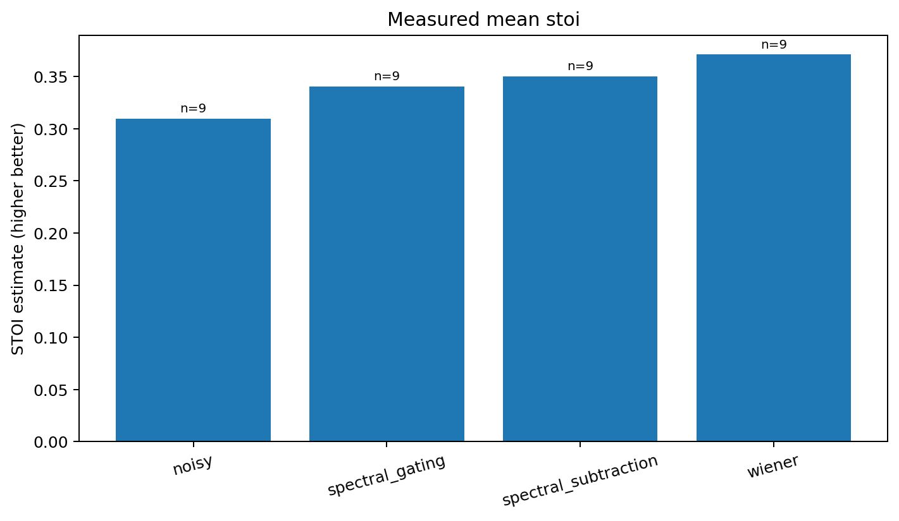
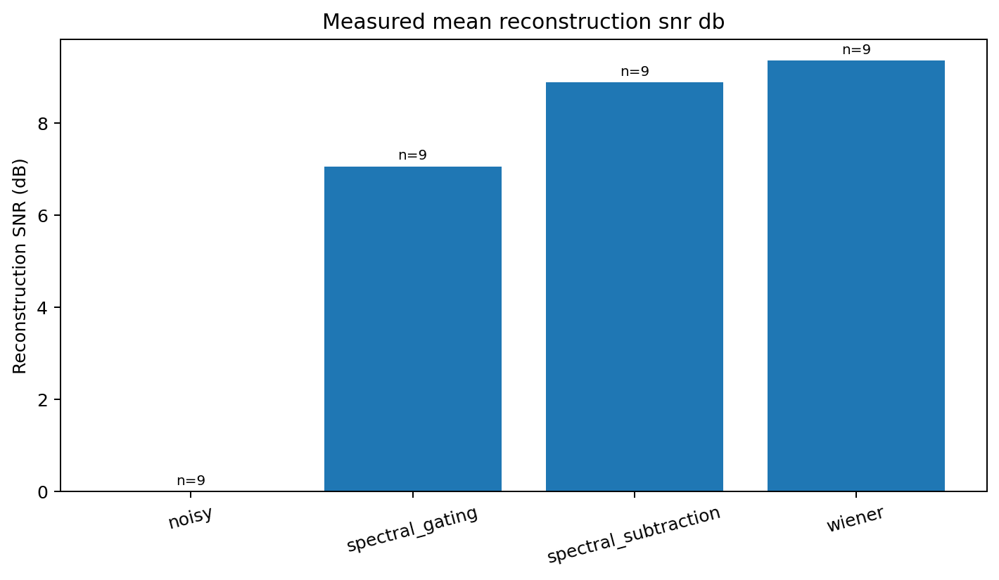
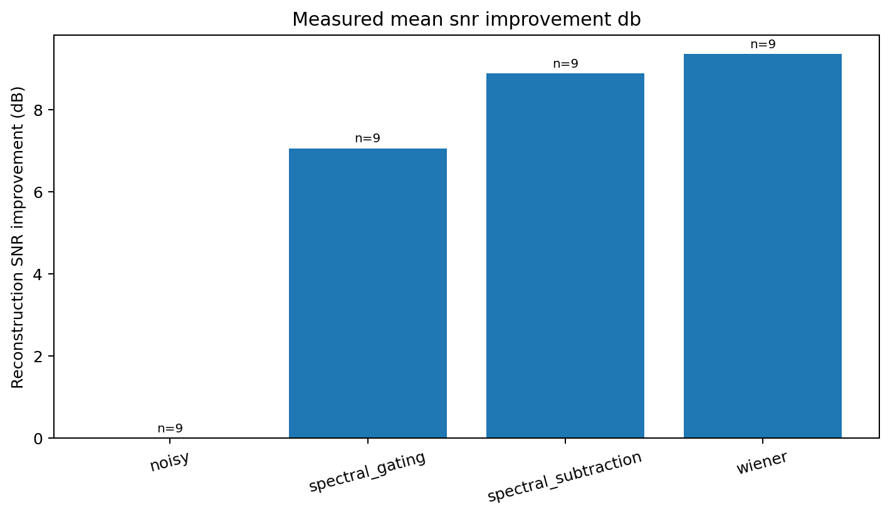
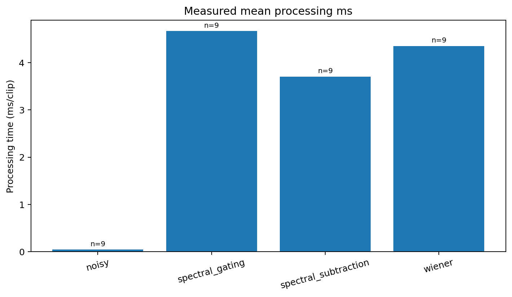
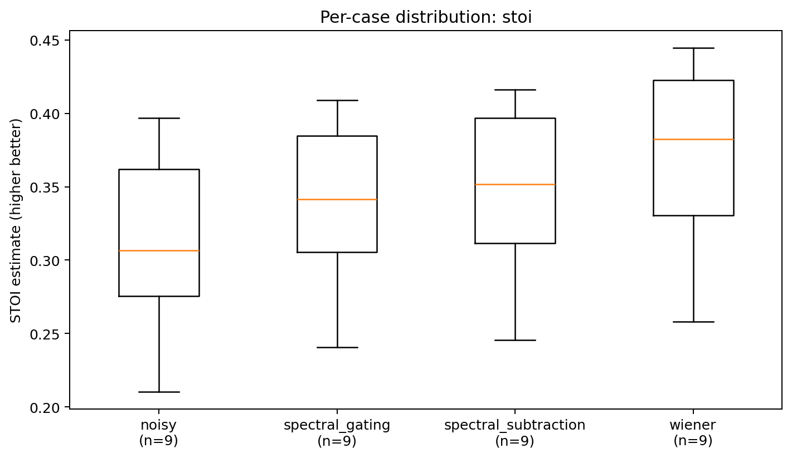
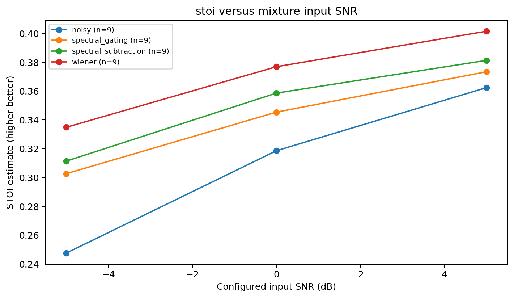
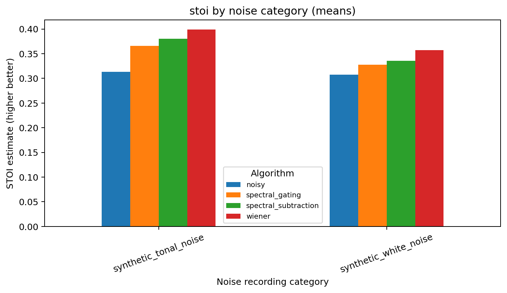
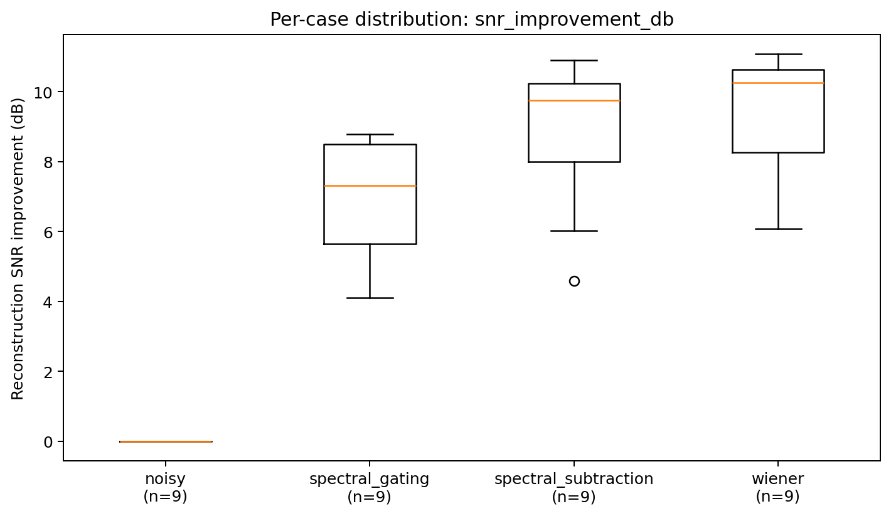
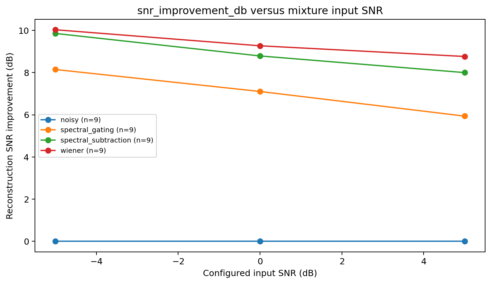
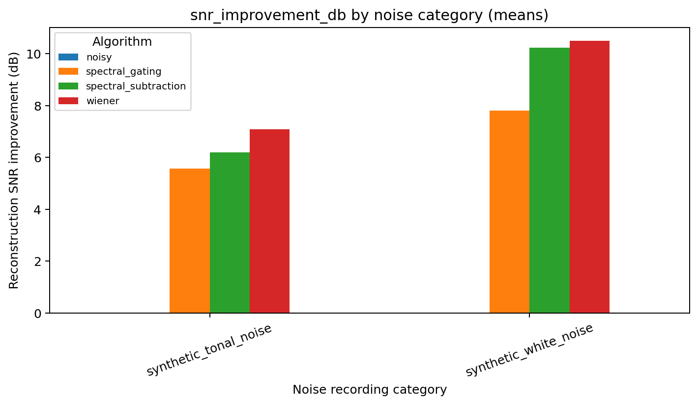
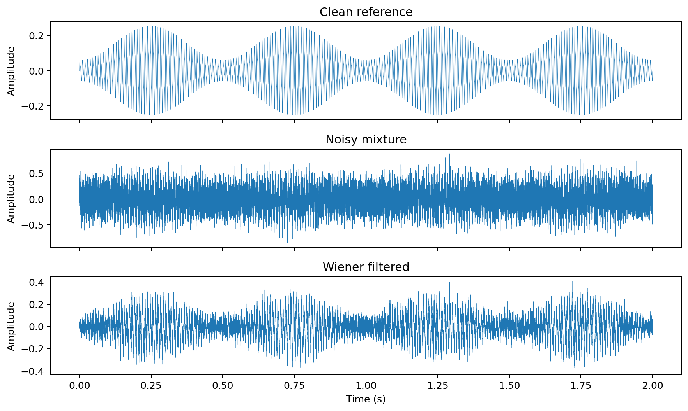
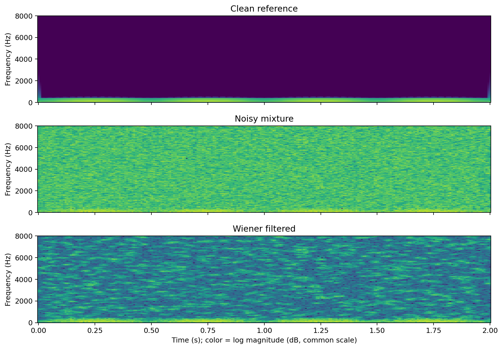

## Discussion, trade-offs, and limitations

Observed mean leaders are descriptive, not proofs of overall superiority. Classical denoisers
may improve reconstruction SNR while suppressing low-energy consonants, changing PESQ and
STOI in different directions. Comparisons are conditional on this selected recording set,
noise PSD profile, one hyperparameter configuration per method, signal segment length,
STFT settings and PESQ/STOI properties. Oracle PSD uses independent *known noise* in synthetic
mixing; this information is unavailable for most live applications, so use blind PSD to test
realistic deployment performance. Processing time excludes resampling, I/O, scoring and
warm-up, and is platform-specific, not end-to-end streaming latency. Real-world study needs
multiple speakers, independent noise recordings, profile mismatch experiments, listener
ratings and pre-registered method selection; error rates and missing scores must be inspected.

## Final evidence-based comparison

**This run uses generated synthetic test signals rather than real speech. The rankings below reflect software behaviour, not measured speech quality or intelligibility.**

Condition leaders above identify *measured maxima*, not a universal winner. Statistical
comparisons are shown only when justified by independent recording counts. Where PESQ is
missing, the PESQ-quality question is left open; synthetic runs describe software behaviour
rather than real-speech quality.

## References and licensing

- Panayotov et al., *LibriSpeech*, ICASSP 2015, CC BY 4.0: https://openslr.org/12/
- Thiemann et al., *DEMAND*, 2013, CC BY-SA 3.0: https://zenodo.org/records/1227121
- Reddy et al., *A Scalable Noisy Speech Dataset and Online Subjective Test Framework*, Interspeech 2019:
  https://github.com/microsoft/MS-SNSD
- ITU-T P.862 (withdrawn): https://www.itu.int/rec/T-REC-P.862
- Taal et al., *An Algorithm for Intelligibility Prediction of Time–Frequency Weighted Noisy Speech*,
  IEEE TASLP 2011 (STOI).
- Wiener, *Extrapolation, Interpolation, and Smoothing of Stationary Time Series*, 1949.
- This repository code uses MIT; dataset licenses and PESQ implementation/IP are **not**
  covered by the project MIT license.
